<picture>
  <source media="(prefers-color-scheme: dark)" srcset="assets/ascii-avatar-dark.svg" />
  <source media="(prefers-color-scheme: light)" srcset="assets/ascii-avatar-light.svg" />
  
</picture>

<picture>
  <source media="(prefers-color-scheme: dark)" srcset="https://readme-typing-svg.demolab.com?font=Fira+Code&weight=600&size=22&duration=3000&pause=900&color=C9D1FF&center=true&vCenter=true&width=620&lines=Tecn%C3%B3logo+en+Redes+de+Datos;Antenas+punto+a+punto+%C2%B7+Servidores+Linux+%C2%B7+Cloud;IA+ag%C3%A9ntica%3A+agentes%2C+APIs+y+automatizaciones" />
  <source media="(prefers-color-scheme: light)" srcset="https://readme-typing-svg.demolab.com?font=Fira+Code&weight=600&size=22&duration=3000&pause=900&color=0A3069&center=true&vCenter=true&width=620&lines=Tecn%C3%B3logo+en+Redes+de+Datos;Antenas+punto+a+punto+%C2%B7+Servidores+Linux+%C2%B7+Cloud;IA+ag%C3%A9ntica%3A+agentes%2C+APIs+y+automatizaciones" />
  
</picture>

 

---

## 🧭 Sobre mí

Soy **Tecnólogo en Redes de Datos** y voy camino a ingeniero. Trabajo en **redes e infraestructura** y mi fuerte es **automatizar con IA**: convertir procesos manuales y caóticos en agentes y bots que hacen el trabajo repetitivo.

Soy curioso por defecto —no puedo usar algo sin preguntarme cómo funciona— y bastante recursivo: cuando no hay camino claro, lo improviso. Mientras dependa de mí, la solución aparece.

> No escribo código desde cero: le doy el trabajo pesado a la IA. **Herramientas, lógica y resultados** — eso sí lo entiendo completo.

---

## 💼 Experiencia

**Infraestructura y redes — empresa actual** · *9 meses*

- Instalación y administración de **enlaces inalámbricos punto a punto de hasta 24 km**: configuración, formateo, alineación y administración.
- Administración de **servidores Linux** de tamaño empresarial medio.
- **Dashboards empresariales** para reporting operativo.
- Servicios en la nube sobre **servidor propio**, con **hardening**, acceso por **claves SSH** y **firewall** configurado.

**Prácticas — SENA, Redes de Datos**

- Configuración de **VLANs**, LAN/WAN y **TCP/IP**.
- Soporte físico: cableado estructurado, diagnóstico de fallas y mantenimiento de equipos.
- Bases de **alta disponibilidad** y **ciberseguridad**.

---

## 🧰 Capacidades

<table align="center">
<tr>
<td align="center" width="33%">

**Enlaces punto a punto hasta 24 km**
Instalación · alineación · administración

</td>
<td align="center" width="33%">

**VLAN · LAN/WAN · TCP/IP**
Alta disponibilidad

</td>
<td align="center" width="33%">

**Linux empresarial · servidor propio**
Hardening · SSH por claves · firewall

</td>
</tr>
<tr>
<td align="center" width="33%">

**Agentes LLM · n8n · APIs**
Docker · Python · PostgreSQL · Git

</td>
<td align="center" width="33%">

**OSINT · Shodan**
Ingeniería inversa asistida con IA

</td>
<td align="center" width="33%">

**Cableado · multímetro · equipos**
Linux/Windows · impresoras

</td>
</tr>
</table>

---

## 🗂️ Proyectos Destacados

<table>
<tr>
<td width="50%">

### 🤖 Bots de WhatsApp para Negocios

No son bots que solo responden "hola". Son agentes que **asesoran, razonan, toman pedidos, agendan citas y consultan la base de datos** en tiempo real. Múltiples bots, múltiples negocios.

**Stack:** `n8n` · `IA agéntica` · `APIs` · `Webhooks` · `BD`

</td>
<td width="50%">

### 📊 Dashboard de Cierres de Mes

Agarro el **excel incomprensible que arroja Gerencia** y lo convierto en un dashboard limpio, original y amigable: gráficas, filtros, todo al instante. De terror contable a experiencia de usuario.

**Stack:** `Visualización` · `Scripts` · `Reporting`

</td>
</tr>
<tr>
<td width="50%">

### 🔍 Automatización de Shodan

Cada día a las **7:00 AM** salía solo un listado de IPs públicas en mi bandeja — test de reconocimiento automatizado con scheduling. Solo fue prueba de concepto, pero dormí tranquilo mientras corrió.

**Stack:** `Shodan` · `Scheduling` · `OSINT`

</td>
<td width="50%">

### 📓 daily-log

Mi bitácora diaria de aprendizaje: TILs, notas y pequeños experimentos. El poder de **aprender en público**, un commit a la vez.

**[→ Ver repo](https://github.com/p4Rd0x-zuD/daily-log)**

</td>
</tr>
</table>

---

## 🏆 Formación y logros

Inglés técnico en progreso: leo documentación, repos y artículos; practicando conversación 📖

---

## 📈 Estadísticas

---

## 🐍 Snake

<picture>
  <source media="(prefers-color-scheme: dark)" srcset="https://raw.githubusercontent.com/p4Rd0x-zuD/p4Rd0x-zuD/output/github-snake-dark.svg" />
  <source media="(prefers-color-scheme: light)" srcset="https://raw.githubusercontent.com/p4Rd0x-zuD/p4Rd0x-zuD/output/github-snake-light.svg" />
  
</picture>

---

## 📬 Contacto

 

*Abierto a oportunidades en redes, infraestructura y automatización con IA.*

 

